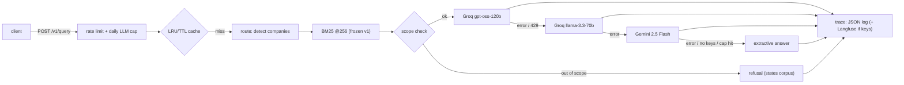

# Production service

This document covers the FastAPI service that serves the frozen retrieval config with cited answers, along with its evals, CI and deployment. Everything here runs on free tiers with no credit card.

## Architecture



| Path | What it does |
|---|---|
| `src/rag_service/config.py` | Frozen retrieval YAML plus runtime settings from env vars |
| `src/rag_service/retriever.py` | Routes the question to companies, then searches BM25, dense or hybrid over `data/index/` |
| `src/rag_service/guardrails.py` | Input cleaning and the deterministic scope check that decides refusals |
| `src/rag_service/generation.py` | Provider chain, prompt rendering, citations, extractive fallback |
| `src/rag_service/llm.py` | Groq and Gemini clients over plain httpx (no SDKs) |
| `src/rag_service/judges.py` | LLM-as-judge with the rubrics in `prompts/judge/` |
| `src/rag_service/tracing.py` | JSON logs, plus the Langfuse ingestion API when keys are set |
| `src/rag_service/api.py` | FastAPI endpoints, Pydantic schemas, slowapi, cache |
| `prompts/answer/v1.md` | Versioned answer prompt; its hash is logged with every trace |
| `eval/golden.jsonl` | 74 questions: 50 benchmark, 12 held-out, 12 unanswerable |
| `eval/run_eval.py` | Offline eval and baseline gate |

The existing benchmark (`benchmark/`, `retrieval/`, `evaluation/`) and the Streamlit dashboard are unchanged. The service reuses their index artifacts and BM25 code, so all three score the same chunks.

## API

```bash
curl -s localhost:8000/v1/query -H 'content-type: application/json' \
  -d '{"question": "How many employees did Tesla have worldwide at the end of 2025?"}'
```

The response contains:

- `answer` with `[n]` citations into `passages`;
- `mode`: `llm`, `extractive` or `refusal`;
- `scope`: the companies searched;
- `provider` and `model`;
- `retrieval_version` and `prompt_version`;
- `cache_hit`, `latency_ms` and `request_id`.

Pass `request_id` to `POST /v1/feedback` as `{"request_id": ..., "rating": 1 | -1}`.

Optional request fields:

- `tickers`: restricts the search to those companies;
- `top_k`: 1–10;
- `include_passages`.

Other endpoints:

- `GET /v1/config` shows the frozen config, which providers are enabled and today's LLM usage.
- `/healthz` reports liveness.
- `/readyz` reports readiness and returns 503 until the indexes are loaded.

**Routing.** If the question names companies (aliases such as "AWS" or "J&J" are included), only those indexes are searched. Comparisons pull the top-k from each company and interleave them. Otherwise one BM25 index over all ten filings is searched.

**Refusals.** Refusals cost no LLM call. The scope check refuses market-data questions, questions about periods after or long before the filings, earnings-call or press questions, and named entities outside the corpus. It also refuses when the passages cover less than 30 % of the question terms. The answer prompt tells the LLM to use the same refusal text, which acts as a second line of defence. The refusal says what is indexed: *latest 10-K per company (fiscal 2025 for most; NVIDIA fiscal 2026)*.

**Limits.**

- `RATE_LIMIT` is per IP, default 10/min.
- `DAILY_LLM_CAP` is a global count of LLM calls per UTC day, default 500, which protects the free quotas. Past the cap the service still answers in extractive mode.

Answers are cached for 6 h per normalised question, config version and prompt version. Degraded answers, meaning extractive output while keys are configured, are not cached.

## Eval results (this commit, no LLM keys)

`python eval/run_eval.py`:

| metric | value | notes |
|---|---|---|
| Hit@5 / MRR / nDCG@5 | 0.903 / 0.784 / 0.807 | 62 answerable questions; a passage counts as relevant only if it contains the gold evidence span, which is stricter than the benchmark's overlap metric |
| Held-out Hit@5 | 0.667 | 8/12 paraphrased questions; see [the decision record](design/retrieval-v1-decision.md) |
| Refusal accuracy | 0.986 | 73/74 |
| Unanswerable recall / refusal precision | 0.917 / 1.0 | The miss is "Exxon market share in Brazilian EV charging"; no answerable question was refused |
| Retrieval latency p50 / p95 | 1.5 ms / 22 ms | p95 comes from the all-company index |

The deterministic rules were tuned while looking at this golden set, so the refusal numbers are optimistic. New unanswerable questions belong in `eval/build_golden.py`.

The **CI gate** compares each PR against `eval/baseline.json`. It fails when Hit@5, MRR or nDCG drop by more than 0.02, when held-out Hit@5 or unanswerable recall drop at all, or when refusal accuracy drops by more than 0.03. To accept an intended change, run `python eval/run_eval.py --update-baseline` and commit the new baseline in the PR.

**Generation eval** (`--generation`) answers every golden question with the LLM chain and scores the answers with two 1–3 rubric judges, faithfulness and correctness. It needs keys, so it only runs in `generation-eval.yml` when prompts, generation code or configs change. Its refusal numbers are stored separately (`refusal_llm`) from the deterministic ones. After the first keyed run, record its numbers with `--generation --update-baseline` so they become gated too.

### Judge calibration (needs your labels)

LLM judges are only worth trusting once you've measured them against a human:

1. Add your keys, then run `python eval/make_labeling_sheet.py` to regenerate `eval/calibration/labeling_sheet.csv` with LLM answers. The committed copy has extractive answers because no keys were available.
2. Fill `human_faithfulness` (1/2/3) for all 30 rows yourself, using `prompts/judge/faithfulness_v1.md`.
3. Run `python eval/calibrate_judge.py`. It writes Cohen's κ (plain and quadratic-weighted) to `eval/calibration/judge_agreement.json`.

Treat judge scores as a gate only if quadratic κ ≥ 0.6. Below that, keep them report-only and fix the rubric.

## Free-stack substitutions

| Original design | What runs here | Why | Tradeoff |
|---|---|---|---|
| Cloud Run | **Hugging Face Docker Space** (`deploy.yml`) | Free CPU (2 vCPU / 16 GB), no card | Sleeps after 48 h without traffic, so the first request after that cold-starts (about 30–60 s for the Space, under 2 s for the app). Disk is ephemeral, so `/v1/feedback` rows reset on restart (traces in Langfuse persist). Public URL only. |
| Cloud Run (kept) | `deploy-cloudrun.yml`, manual and disabled by default | Same image works there | Needs a GCP billing account with a card, although low traffic fits the always-free tier |
| Paid LLM API | **Groq free tier** (`openai/gpt-oss-120b`, falling back to `llama-3.3-70b-versatile`), then **Gemini free tier** (`gemini-2.5-flash`) | No card; Groq is very fast | Per-minute and per-day request limits, and model IDs get retired. Override with `GROQ_MODEL` / `GROQ_FALLBACK_MODEL` and check https://console.groq.com/docs/models. Free-tier Gemini prompts may be used by Google to improve products, so don't send private data. |
| Judge model | Gemini 2.5 Flash (falls back to Groq) | Free; a different family from the main answerer (gpt-oss) limits self-preference bias | Same family as the fallback answerer; weaker than a frontier judge, hence the κ calibration step |
| Langfuse Cloud | Langfuse **Hobby** (free) when keys are set, otherwise JSON logs | Zero-config default | Hobby has a monthly event quota and short retention. JSON logs on HF are only visible in the Space's log tab. |
| Managed vector DB | BM25 in-process; prebuilt index baked into the image | Best quality and zero cost | Re-indexing means rebuilding the image (`scripts/build_indexes.py`, then commit `data/index/`) |
| CI | GitHub Actions | Free for public repos | Generation eval spends free LLM quota, so it is path-filtered and skipped without secrets |

## Run locally

```bash
pip install -r requirements-dev.txt
PYTHONPATH=.:src uvicorn rag_service.api:app --port 8000   # http://localhost:8000/docs
pytest && python eval/run_eval.py

# or in Docker
cp .env.example .env    # keys optional
docker compose up --build                                  # http://localhost:8000/docs
```

## Deploy (Hugging Face Spaces)

1. Create a Hugging Face account and a **write** token at https://huggingface.co/settings/tokens.
2. In GitHub, go to **Settings → Secrets and variables → Actions**. Add:
   - secret `HF_TOKEN`;
   - variable `HF_SPACE`, for example `Vaibhav-1614/rag-10k-api`;
   - optional secrets `GROQ_API_KEY`, `GEMINI_API_KEY`, `LANGFUSE_PUBLIC_KEY`, `LANGFUSE_SECRET_KEY`.
3. Merge to `main`, or run **Deploy to Hugging Face Spaces** by hand. The workflow:
   - runs the same tests and eval gate as PRs;
   - creates the Space if needed and copies the keys into its secrets;
   - uploads only the files the image needs;
   - smoke-tests `https://<user>-<space>.hf.space`.

## Switching to hybrid

```bash
pip install -r requirements-dense.txt
python eval/run_eval.py --config configs/retrieval/v1-hybrid.yaml --no-gate
docker build --build-arg WITH_DENSE=1 -t rag-service:hybrid .
docker run -e RETRIEVAL_CONFIG=/app/configs/retrieval/v1-hybrid.yaml -p 8000:7860 rag-service:hybrid
```
