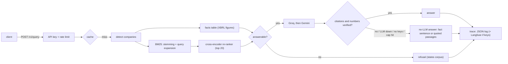

# Production service

This document covers the FastAPI service that answers questions over the indexed 10-K filings, along with its evals, CI and deployment. Everything runs on free tiers with no credit card, on CPU, without torch.

## Architecture



| Path | What it does |
|---|---|
| `ingestion/structured_chunker.py` | Section- and table-aware chunks with a context line (company, fiscal year, item, heading) |
| `scripts/build_index_v2.py` | Writes `data/index/v2/` (chunks and bge-small embeddings) |
| `scripts/build_facts.py` | Writes `data/facts/facts.json` from SEC XBRL data for the indexed filings |
| `src/rag_service/retriever.py` | Company routing; v2 retriever (BM25, optional dense, re-ranker); v1 retriever kept |
| `src/rag_service/textproc.py` | Stemming tokenizer, query expansion, BM25 over an inverted index |
| `src/rag_service/facts.py` | Detects company-wide metrics; answers figures, comparisons and rankings |
| `src/rag_service/guardrails.py` | Input cleaning and rules for what a 10-K cannot contain |
| `src/rag_service/pipeline.py` | Facts lookup, retrieval, answerability, generation |
| `src/rag_service/generation.py` | Provider chain, citation verification, no-LLM answers |
| `src/rag_service/api.py` | Endpoints, schemas, rate limit, API keys, cache, streaming |
| `src/rag_service/store.py` | Feedback and usage counter in SQLite or Postgres |
| `configs/retrieval/v2.yaml` | Production retrieval config ([decision record](design/retrieval-v2-decision.md)) |
| `prompts/answer/v2.md` | Versioned answer prompt; its hash is logged with every trace |
| `eval/` | Golden set (176 questions), eval runner, baseline, judge calibration |

The benchmark (`benchmark/`, `retrieval/`, `evaluation/`), the v1 index and the Streamlit dashboard are unchanged.

## How a question is answered

1. **Companies.** Names and aliases in the question select the filings ("AWS", "J&J"). Two or more companies get passages from each. "Which company …" with no name fans out across all ten.
2. **Facts.** If the question asks for a company-wide figure (revenue, net income, cash, R&D, headcount and others), the exact value from the filing's XBRL data is added as the first source. Questions narrowed to a product, segment, region, quarter or forecast skip this step and use the text.
3. **Text retrieval.** BM25 over stemmed text with query expansion returns 20 candidates. A cross-encoder re-ranks them and the top 5 are kept.
4. **Answerability.** The service refuses when:
   - the question is about market data, earnings calls, forecasts for the next period, or a period outside the filings;
   - a named company or entity is outside the corpus;
   - the re-ranker's score for the best passage is below `min_evidence_score`.
5. **Generation.** Groq `openai/gpt-oss-120b`, then Groq `llama-3.3-70b-versatile`, then Gemini 2.5 Flash. Without keys, or past the daily cap, the answer is the fact sentence or the passage sentences the re-ranker scores highest.
6. **Verification.** In an LLM answer, every sentence must cite a source, and every number in it must appear in a source it cites (unit restatements such as "$416.2 billion" for 416,161 million are accepted). Sentences that fail are removed; if none survive, the no-LLM answer is returned. The response's `verification` field lists what was dropped.

## API

```bash
curl -s localhost:8000/v1/query -H 'content-type: application/json' \
  -d '{"question": "Who spends more on R&D, Apple or Microsoft?"}'
```

The response contains:

- `answer` with `[n]` citations into `passages`;
- `mode`: `llm`, `extractive` or `refusal`;
- `passages`, each with `kind` (`fact`, `table` or `text`), `section` (the 10-K item), `fiscal_year` and `source_url` (the filing on sec.gov);
- `verification`, `provider`, `model`, `retrieval_version`, `prompt_version`, `cache_hit`, `latency_ms` and `request_id`.

Other endpoints:

- `POST /v1/query/stream` sends server-sent events: `passages` right after retrieval, then `answer`, then `done`. The answer arrives whole, because it is only released after verification.
- `POST /v1/feedback` takes `{"request_id": ..., "rating": 1 | -1}`.
- `GET /v1/config` shows the retrieval config, enabled providers, limits and storage backend.
- `/healthz` reports liveness; `/readyz` returns 503 until the index and models are loaded.

### Limits and access

| Setting | Default | Effect |
|---|---|---|
| `RATE_LIMIT` | `10/minute` | Per caller: per API key when keys are on, otherwise per IP |
| `TRUSTED_PROXY_HOPS` | `0` | How many reverse proxies in front of the app append to `X-Forwarded-For`. Entries the client supplies are ignored. Set to `1` on Hugging Face Spaces and Cloud Run (the deploy scripts do this). |
| `API_KEYS` | empty | Comma-separated keys. When set, `/v1/*` requires an `X-API-Key` header. |
| `DAILY_LLM_CAP` | `500` | LLM provider calls per UTC day across all callers. Fallback attempts count too. Past the cap the service answers without an LLM. |
| `DATABASE_URL` | empty | Postgres for feedback and the usage counter. Empty uses a SQLite file. |

After deploying, check the rate limit sees real client addresses: send requests from two networks and confirm they are limited separately. If the host's proxy chain differs, adjust `TRUSTED_PROXY_HOPS`.

## Eval results (this commit, no LLM keys)

`python eval/run_eval.py` on the 176-question golden set:

| Metric | v2 | v1 on the same set |
|---|---|---|
| Hit@5 / MRR | 0.986 / 0.945 | 0.730 / 0.580 |
| Hit@5 on the held-out test split (43 questions) | 1.000 | 0.628 |
| Answer check: known figure or phrase present (68 questions) | 0.971 | 0.206 |
| Unanswerable questions refused (28) | 1.000 | 0.786 |
| Answerable questions wrongly refused (148) | 0.000 | 0.014 |
| Latency p50 / p95, retrieval and re-ranking | 0.45 s / 1.2 s | 2 ms / 11 ms |

By question type (v2):

| Type | Questions | Hit@5 | MRR | Answer check |
|---|---|---|---|---|
| Lookup (one fact in the text) | 78 | 0.974 | 0.908 | 0.875 |
| Numeric (company-wide figure) | 38 | 1.000 | 0.987 | 1.000 |
| Comparison (two companies) | 8 | 1.000 | 1.000 | 1.000 |
| Cross-company ranking | 6 | 1.000 | 1.000 | 1.000 |
| Thematic (risk factors, properties, …) | 18 | 1.000 | 0.972 | not checked |

How to read these:

- **Relevance is strict.** A passage counts only if it contains the gold evidence span or figure. For thematic questions it must come from the right 10-K item and match a topic pattern.
- **The answer check runs without an LLM.** It shows the facts path and sentence selection work. It does not measure LLM answers.
- **Splits.** The 74 v1 questions are all `dev`. Each new type is split half `dev`, half `test`. Rules, expansion terms and the evidence threshold were tuned on `dev` only, with one exception described in the [decision record](design/retrieval-v2-decision.md).
- **I wrote the new questions**, so the test split is optimistic compared with real users.

The **CI gate** compares each PR against `eval/baseline.json`. It fails when:

- Hit@5, MRR or nDCG drop by more than 0.02;
- test-split Hit@5 or the answer check drop by more than 0.03;
- refusal accuracy drops by more than 0.02, or unanswerable recall by more than 0.04;
- the false-refusal rate rises by more than 0.02.

To accept an intended change, run `python eval/run_eval.py --update-baseline` and commit the baseline in the PR.

### Not measured yet: LLM answers

`python eval/run_eval.py --generation` answers every golden question with the LLM chain and scores faithfulness and correctness with two rubric judges. It needs `GROQ_API_KEY` and/or `GEMINI_API_KEY`, and has not been run. Once keys are set:

1. Run it, then record the numbers with `--generation --update-baseline` so they are gated.
2. Calibrate the judge against your own labels:
   - `python eval/make_labeling_sheet.py` regenerates `eval/calibration/labeling_sheet.csv` with LLM answers;
   - fill `human_faithfulness` (1/2/3) for the 30 rows yourself;
   - `python eval/calibrate_judge.py` reports Cohen's κ. Gate on judge scores only if quadratic κ ≥ 0.6.

## Known limits

- **Latency.** The re-ranker makes a query take about half a second on 4 CPU cores. `configs/retrieval/v2-bm25.yaml` answers in about 1 ms without it, at lower ranking quality and without evidence-based refusal.
- **Facts cover company totals only.** Segment and product figures come from table chunks, which the no-LLM path quotes as rows.
- **Microsoft's tables** lost their year header row and the closing bracket on negatives during parsing. Fixing that needs a re-parse of the raw filing.
- **The corpus is one filing per company** and is ageing: Apple has filed a newer 10-K since.
- **Refusal rules** for periods and market data are still patterns, and the evidence threshold was set on 20 questions.

## Free-stack substitutions

| Original design | What runs here | Tradeoff |
|---|---|---|
| Cloud Run | Hugging Face Docker Space (`deploy.yml`) | Free CPU, no card. Sleeps after 48 h idle; disk is wiped on restart. |
| Cloud Run (kept) | `deploy-cloudrun.yml`, manual | Needs a GCP billing account with a card |
| Paid LLM API | Groq free tier, then Gemini free tier | Request limits; model IDs get retired (override with `GROQ_MODEL`, `GROQ_FALLBACK_MODEL`). Free-tier Gemini prompts may be used by Google, so don't send private data. |
| Judge model | Gemini 2.5 Flash, falling back to Groq | Weaker than a frontier judge, hence the κ calibration |
| Langfuse Cloud | Langfuse Hobby when keys are set, otherwise JSON logs | Monthly event quota and short retention |
| Managed vector DB | Index files baked into the image; BM25 and exact cosine in memory | Re-indexing means rebuilding the image |
| GPU embedding service | ONNX models on CPU through fastembed | About 0.5 s per query for re-ranking |
| Managed Postgres | Optional: Neon or Supabase free tier through `DATABASE_URL` | Without it, feedback and the usage counter reset when the Space restarts |
| CI | GitHub Actions | Generation eval spends free LLM quota, so it is path-filtered and skipped without secrets |

## Run locally

```bash
pip install -r requirements-dev.txt
python scripts/fetch_models.py configs/retrieval/v2.yaml   # one-time model download (about 90 MB)
PYTHONPATH=.:src uvicorn rag_service.api:app --port 8000   # http://localhost:8000/docs
pytest && python eval/run_eval.py

# or in Docker
cp .env.example .env    # keys optional
docker compose up --build                                  # http://localhost:8000/docs
```

Switch configs with `RETRIEVAL_CONFIG`, for example `configs/retrieval/v2-hybrid-rerank.yaml`, `v2-bm25.yaml` or `v1.yaml`.

## Rebuild the data

```bash
python scripts/build_facts.py        # SEC XBRL figures for the indexed filings
python scripts/build_index_v2.py     # chunks and embeddings (about 45 min on 4 CPU cores)
python eval/build_golden.py          # re-verifies every golden question against the filings
```

SEC asks automated clients to identify themselves: set `SEC_USER_AGENT` to your name and contact address.

## Deploy (Hugging Face Spaces)

1. Create a Hugging Face account and a **write** token at https://huggingface.co/settings/tokens.
2. In GitHub, go to **Settings → Secrets and variables → Actions**. Add:
   - secret `HF_TOKEN`;
   - variable `HF_SPACE`, for example `Vaibhav-1614/rag-10k-api`;
   - optional secrets `GROQ_API_KEY`, `GEMINI_API_KEY`, `LANGFUSE_PUBLIC_KEY`, `LANGFUSE_SECRET_KEY`, `DATABASE_URL`, `API_KEYS`.
3. Merge to `main`, or run **Deploy to Hugging Face Spaces** by hand. The workflow:
   - runs the same tests and eval gate as PRs;
   - creates the Space if needed and copies the secrets into it;
   - uploads only the files the image needs;
   - smoke-tests `https://<user>-<space>.hf.space`.
